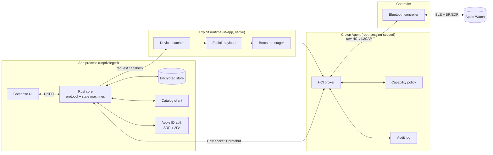
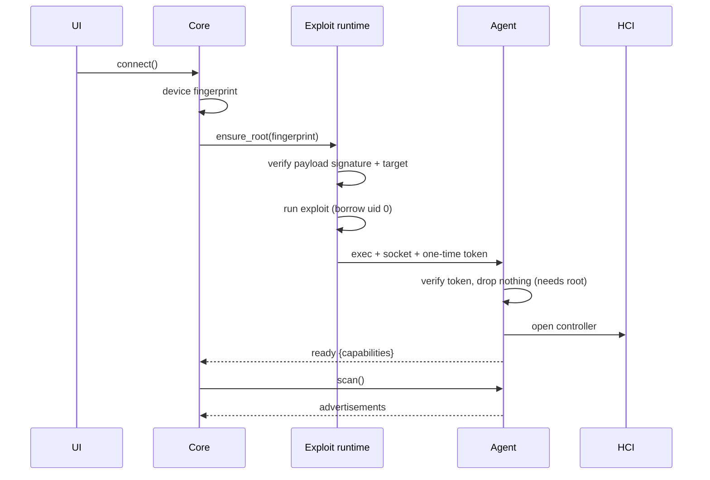

# 02 — Architecture

## 1. Shape

Open Crown is four cooperating pieces with one rule: **the UI never touches the
radio, the radio never trusts the UI, and root never outlives the session.**



## 2. Components

### 2.1 App process (`app/`, `core/`, `ffi/`)

| Component | Responsibility | Never does |
| --- | --- | --- |
| Compose UI | Screens, consent, progress, logs | Talks to the radio |
| Rust core | Advertising decode, session state machine, protocol codecs, crypto, persistence model | Opens sockets or files outside its sandbox |
| Catalog client | Fetch/verify payload manifests | Executes payloads |
| Auth | Apple ID SRP sign-in, 2FA relay, token storage | Stores the password |
| Store | Pair records, bonds, settings, audit log (encrypted at rest) | Stores plaintext keys |

The core is pure logic: bytes and events in, actions out. That makes it
testable with golden vectors and portable to a desktop bridge later.

### 2.2 Exploit runtime (`runtime/`)

A native library loaded by the app. It is the only code allowed to run before
privilege is obtained, and it is deliberately small.

- **Device matcher** — reads model, kernel release, build id, ABI, Android SDK;
  computes a fingerprint; selects a catalog payload.
- **Exploit payload** — a signed, device-matched chain (page-cache write,
  futex/UAF, or a future family). It borrows uid 0 for the session.
- **Bootstrap stager** — starts the agent through the exploit's
  usermode-helper path, passes it a socket and a one-time token, and verifies
  the handshake.

The runtime never parses Watch protocol messages and never writes persistent
state to the boot image.

### 2.3 Crown Agent (`agent/`)

A small root process, started on demand and killed at session end.

- **HCI broker** — opens the controller, sets link policy, exposes a narrow,
  typed API: `scan`, `connect(addr)`, `open_l2cap(psm, mode)`,
  `send(handle, bytes)`, `close`.
- **Policy** — enforces the capability table, rate limits, and the audit log.
- **Audit** — append-only record of every privileged action.

The agent never parses Watch protocol messages. It moves bytes.

### 2.4 Catalog (`catalog/`)

Signed bundles that grant capabilities and start the agent. Details in
[04 — Payload system](04-payload-system.md). The catalog is data, not code in
the app, so it can be updated without shipping a new APK.

## 3. Bootstrap sequence



Failure at any step rolls back to `IDLE` and surfaces the exact reason:
`no_payload`, `signature_invalid`, `target_mismatch`, `exploit_failed`,
`agent_handshake_failed`, `hci_open_failed`.

## 4. Process and trust model

| Boundary | Mechanism | Trust |
| --- | --- | --- |
| UI ↔ core | UniFFI, in-process | Same app |
| Core ↔ agent | Unix socket, protobuf, one-time token, peer-cred UID check | Mutual |
| Runtime ↔ payload | Signature + exact target match | Lowest until verified |
| Agent ↔ controller | Raw HCI | Full device control; hence policy |
| Core ↔ Apple | TLS pinned, token auth | External |

The agent is the only component that can hurt the phone. It is kept small,
auditable, and replaceable. It runs with root only for the session and exits
when the session ends.

## 5. Session model

```text
IDLE → DISCOVERING → SELECTED → PRIVILEGE → PAIRING → SECURING
     → ACTIVATING → SYNCING → READY → RECONNECTING → READY
```

Every transition is persisted with a checkpoint ordinal, the evidence that
justified it, and the protocol version. A later boot resumes from the last
durable checkpoint; it never replays a non-idempotent step.

`READY` is not a single boolean. It requires: bond material present, encrypted
link verified, activation confirmed, setup completed, and a visible-face
observation (or owner confirmation). The UI shows these as separate checks so a
partial success cannot masquerade as a working watch.

`PRIVILEGE` is also a checkpoint: the app records which payload ran, its
signature, and the capability set granted. On reboot, the checkpoint is marked
`stale` and must be re-earned.

## 6. Data model (sketch)

```text
PairRecord
  id, watch_identifier, model, watchos_version, protocol_version
  created_at, last_seen_at, state, checkpoints[]
  bond_ref, activation_ref, setup_ref

BondRecord
  id, pair_id, ltk_ref, irk_ref, address, address_type
  (key material lives in a hardware-backed keystore, referenced not embedded)

PayloadManifest
  id, version, target{model, kernel_build, abi}, capabilities[]
  artifacts[{name, sha256, size}], signature, min_agent_version

AuditEvent
  ts, actor, action, payload_id, capability, result, session_id

AuthSession
  id, apple_id_hint (hashed), token_ref, expires_at
  (never the password; tokens are revocable and short-lived)
```

## 7. Transport abstraction

The core talks to a `Transport` trait, not to Bluetooth:

```rust
trait Transport {
    fn scan(&self, filter: ScanFilter) -> Stream<Advertisement>;
    fn connect(&self, peer: PeerId) -> Result<Link>;
    fn open_channel(&self, link: &Link, psm: u16, mode: ChannelMode) -> Result<Channel>;
    fn send(&self, ch: &Channel, data: &[u8]) -> Result<()>;
}
```

Implementations, in order of preference:

1. `AgentTransport` — raw HCI via the agent (Android, primary).
2. `BridgeTransport` — a desktop host over the network (fallback for devices
   with no payload).
3. `MockTransport` — recorded traces for tests.

The core must not know which one it is using.

## 8. Failure handling

| Failure | Behaviour |
| --- | --- |
| No matching payload | Discovery-only mode; explain which builds are supported |
| Payload rejected | Session aborts, audit event, no partial state committed |
| Exploit panics / reboots | Session lost; on next boot the app reports the failed run, no loop |
| Agent unavailable | Retry once, then offer bridge mode |
| Radio wedged | Agent resets the controller and reports; core rolls back |
| Watch resets | New identity detected; fresh pairing required |
| Protocol drift | Version mismatch is a first-class error, not a parse crash |
| Reboot mid-session | All privilege state marked stale; no silent re-root |

## 9. What is deliberately absent

- No Flutter, no shared Dart runtime.
- No persistent su, no Magisk dependency in the app.
- No hidden-API bypass inside the UI process.
- No custom kernel as a requirement.
- No desktop-only architecture: Android is the primary target.
- No watch-side code, ever.
