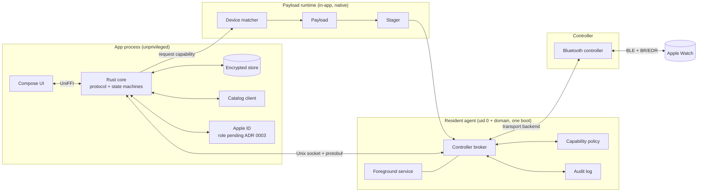
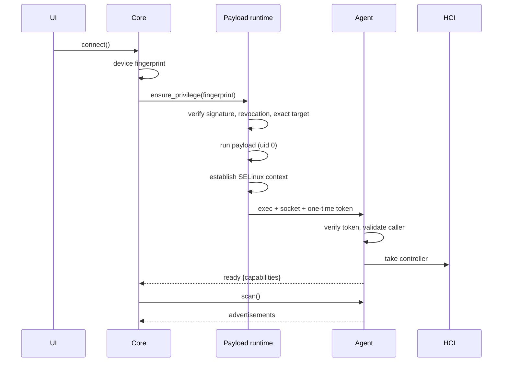

# 02 — Architecture

## 1. Shape

Open Crown is four cooperating pieces with one rule: **the UI never touches the
radio, the agent never trusts the UI, and privilege never outlives the boot.**



## 2. Components

### 2.1 App process (`app/`, `core/`, `ffi/`)

| Component | Responsibility | Never does |
| --- | --- | --- |
| Compose UI | Screens, consent, progress, logs | Talks to the radio |
| Rust core | Advertising decode, session state machine, codecs, crypto, persistence model | Opens sockets or files outside its sandbox |
| Catalog client | Fetch/verify manifests | Executes payloads |
| Auth | Apple ID flow, role pending ADR 0003 | Stores a password |
| Store | Pair records, wrapped bonds, settings, audit export | Stores plaintext link keys |

The core is pure logic: bytes and events in, actions out. It is testable with
golden vectors and portable to the desktop harness.

### 2.2 Payload runtime (`runtime/`)

A native library loaded by the app. It is the only code allowed to run before
privilege is obtained, and it is deliberately small.

- **Device matcher** — model, kernel release, build id, ABI, SDK; selects an
  exact-target payload.
- **Payload** — a signed chain that yields `uid 0` and an SELinux context that
  can hold the controller. See [ADR 0007](adr/0007-uid0-plus-domain.md).
- **Stager** — starts the agent, passes a socket and a one-time token, verifies
  the handshake.

The runtime never parses Watch protocol messages and never writes to the boot
image.

### 2.3 Agent (`agent/`)

A small privileged process, resident for the life of the boot while a watch is
paired.

- **Controller broker** — opens the controller, sets link policy, exposes a
  narrow typed API: `scan`, `connect(addr)`, `open_channel(psm, mode)`,
  `send(handle, bytes)`, `close`.
- **Policy** — capability table, rate limits, envelope validation.
- **Audit** — append-only record of every privileged action.
- **Service** — a foreground service with a visible notification; the agent is
  not allowed to be invisible.

The agent never parses Watch protocol messages. It moves bytes.

### 2.4 Catalog (`catalog/`)

Signed bundles that grant capabilities and start the agent. Details in
[04 — Payload system](04-payload-system.md). The catalog is data, not code in
the app, so it can be updated without a new APK.

## 3. Transport: two shapes, one decision

The agent can hold the controller in two ways. Which one is viable is the first
experiment, not a matter of taste.

| Shape | How | Cost |
| --- | --- | --- |
| **A — HAL ownership** | The agent takes the Bluetooth HAL, as the prior art does | Needs priv-app, hidden-API whitelist and SELinux rules; that is the configuration we are trying to avoid |
| **B — HCI user channel** | The agent detaches the platform stack, owns HCI, implements L2CAP/ERTM/SDP/SMP in userspace | Needs an SELinux domain that can open the device; a large userspace stack to write |

Shape B is the thesis. If K2a fails for B but succeeds for A, then the honest
product is a rooted-device companion with a Magisk-class prerequisite, and
[ADR 0010](adr/0010-ship-order.md) already orders the release that way.

The core does not know which shape is in use.

## 4. Bootstrap sequence



Failure at any step rolls back to `IDLE` and surfaces the exact reason:
`no_payload`, `signature_invalid`, `target_mismatch`, `exploit_failed`,
`selinux_denied`, `agent_handshake_failed`, `controller_busy`.

## 5. Process and trust model

| Boundary | Mechanism | Trust |
| --- | --- | --- |
| UI ↔ core | UniFFI, in-process | Same app |
| Core ↔ agent | Unix socket, protobuf, one-time token, peer-cred UID + signature | **The app is untrusted** |
| Runtime ↔ payload | Signature, revocation, exact target | Lowest until verified |
| Agent ↔ controller | Controller ownership | Full control; hence policy |
| Core ↔ Apple | TLS pinned, token auth | External |

The agent is the only component that can hurt the phone. It is kept small,
auditable, and replaceable, and it validates every envelope because the app
process is the component most likely to be compromised. A compromised app can
still ask for radio operations — the policy limits *which*, not *whether*.

## 6. Agent lifecycle

```text
raised (once per boot, after a user gesture)
  → resident behind a foreground service while a watch is paired
  → visible notification with an explicit "stop" action
  → exits when the user unpairs or stops the app
  → exits on watchdog when the app disappears for longer than the grace period
  → gone at reboot; nothing restores it
```

The agent is a daemon. The documents say so instead of calling it a session.

## 7. Session model

```text
IDLE → DISCOVERING → SELECTED → PRIVILEGE → PAIRING → SECURING
     → ACTIVATING → SYNCING → READY → RECONNECTING → READY
```

Every transition is persisted with a checkpoint ordinal, the evidence that
justified it, and the protocol version. A later boot resumes from the last
durable checkpoint; it never replays a non-idempotent step.

`READY` is not a single boolean. It requires: bond material present and
provisioned to the controller, encrypted link verified, device activated, setup
completed, and a visible-face observation or owner confirmation. The UI shows
these separately so a partial success cannot masquerade as a working watch.

`PRIVILEGE` is a checkpoint: which payload ran, its signature, the capability
set, and the SELinux context it obtained. On reboot it is marked `stale`.

## 8. Data model

```text
PairRecord
  id, watch_identifier, model, watchos_version, protocol_version
  created_at, last_seen_at, state, checkpoints[]

BondRecord
  id, pair_id, address, address_type, ltk_ref, irk_ref
  (the link key is wrapped by the Android Keystore, but the controller needs the
   key itself; the agent provisions it into the controller at boot)

PayloadManifest
  id, version, target{model, kernel_build, abi, sdk}, capabilities[]
  artifacts[{name, sha256, size}], signature, min_agent_version

AuditEvent
  ts, actor, action, payload_id, capability, result, boot_id

AuthSession
  id, apple_id_hint (hashed), token_ref, expires_at
  (role and necessity pending ADR 0003)
```

## 9. Transport abstraction

The core talks to a `Transport` trait, not to Bluetooth:

```rust
trait Transport {
    fn scan(&self, filter: ScanFilter) -> Stream<Advertisement>;
    fn connect(&self, peer: PeerId) -> Result<Link>;
    fn open_channel(&self, link: &Link, psm: u16, mode: ChannelMode) -> Result<Channel>;
    fn send(&self, ch: &Channel, data: &[u8]) -> Result<()>;
}
```

Implementations, in preference order:

1. `AgentTransport` — the resident agent (Android, primary).
2. `DesktopTransport` — the Linux/Windows HCI harness used for protocol work.
3. `MockTransport` — recorded traces for tests.

## 10. Failure handling

| Failure | Behaviour |
| --- | --- |
| No matching payload | Bring-your-own-root prompt, or discovery-only mode with the supported list |
| Payload rejected | Session aborts, audit event, no partial state committed |
| SELinux denial | Session aborts with the denial recorded; no retry loop |
| Payload panics / reboots | Session lost; next boot reports the failed run, no auto-retry |
| Agent dies | Foreground service restarts it once; then the session ends with a reason |
| Radio wedged | Agent resets the controller and reports; core rolls back |
| Watch resets | New identity detected; fresh pairing required |
| Protocol drift | Version mismatch is a first-class error, not a parse crash |
| Reboot mid-session | All privilege state marked stale; no silent re-root |

## 11. What is deliberately absent

- No Flutter, no shared Dart runtime in the product.
- No persistent su, no Magisk dependency in the product.
- No hidden-API bypass inside the UI process.
- No custom kernel as a requirement.
- No desktop-only architecture: Android is the primary target.
- No watch-side code, ever.
