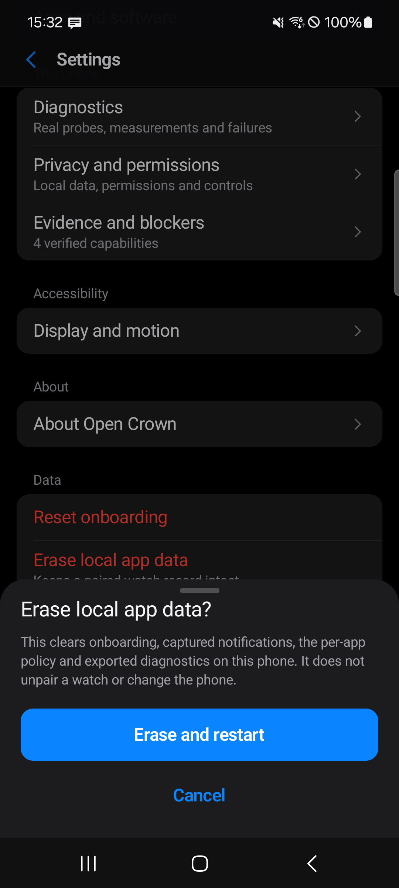
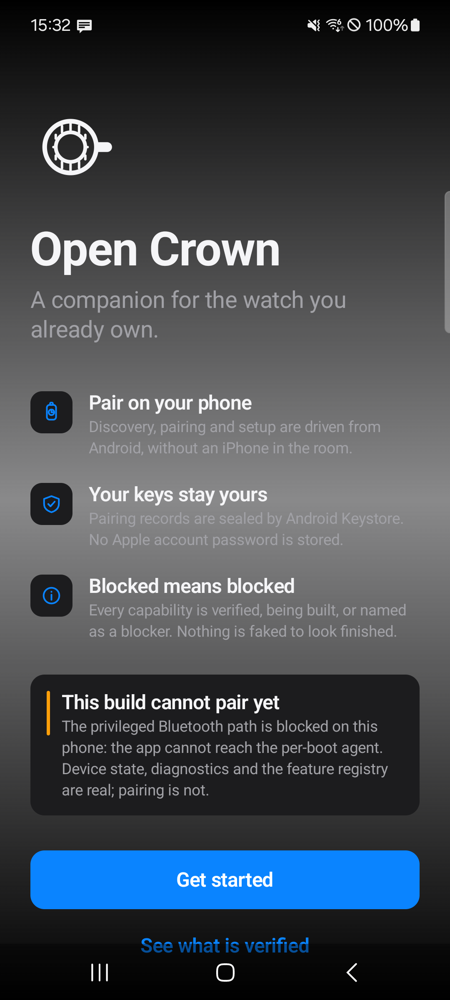

# A52 local app-data reset

Date: 2026-11-22 15:34 Europe/Berlin
Device: Samsung SM-A528B (a52sxq), Android 14 / SDK 34.
Build: Open Crown debug APK from this tree, versionName 0.1.0.
Serial: withheld.
Apple Watch: not present.

## Setup

- Granted notification-listener access.
- Posted a synthetic notification, captured locally.
- The app had a diagnostics cache directory from an earlier export.

## Action

Settings -> Data -> **Erase local app data** -> **Erase and restart**.

## Result

- The app returned to the Welcome/onboarding screen.
  
- The diagnostics cache directory no longer existed
  (cache/diagnostics: No such file or directory).
- Onboarding returned to first-run state.
- The captured notification buffer was cleared in memory; the per-app policy
  key was removed.
- Android still lists Open Crown notification access as granted. Erasing
  app-local data is not a system permission revoke; the user must revoke it in
  Android settings, and the confirmation sheet says so.

## Guard

If a pair record exists, the app refuses local erasure with an "Unpair the watch
first" sheet instead of deleting the record and orphaning the watch. That branch
could not be exercised on hardware because there is no Apple Watch and no
pairing implementation; it has no host test yet.

## Limits

- This tests one no-pair device. It does not test a populated pair store,
  corrupt sealed data or a concurrent notification.
- The Android notification-listener grant is intentionally not revoked by the
  app.
