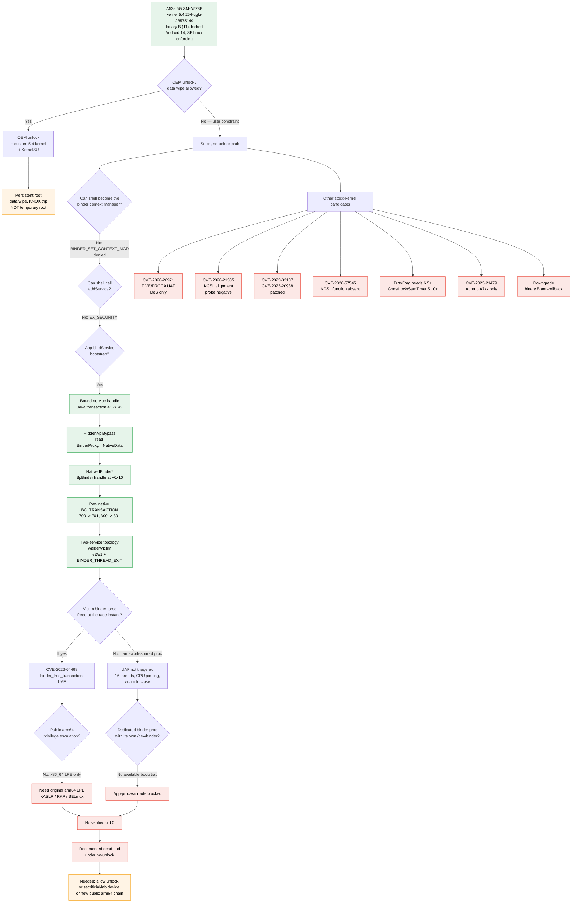

# A52s chain attempt — full overview and flowchart

**Status:** research only — **no working root**. The goal is blocked under the
no-unlock / no-wipe constraint. This document is the one-page map of what was
built, what was verified, what failed, and why.

**Target:** Samsung Galaxy A52s 5G `SM-A528B` (`a52sxq`), Snapdragon 778G
`SM7325`, Adreno 642L, arm64-v8a, Android 14 / SDK 34, kernel
`5.4.254-qgki-28575149-abA528BXXSBGYI3`, build `A528BXXSBGYI3`, SPL
`2025-09-01`, bootloader binary **B (11)**, locked, warranty bit 0,
verified boot green, SELinux enforcing.

**Constraint:** stock kernel, locked bootloader, no OEM unlock, no data wipe,
no persistent change. The current phone was used for tests and was never
rooted.

**Related documents:**

- [No-unlock dead end](../evidence/a52-no-unlock-dead-end.md)
- [Bootstrap evidence](../evidence/a52-binder-bootstrap.md)
- [Topology harness evidence](../evidence/a52-binder-harness.md)
- [A52 payload search](a52-payload-search.md)
- [A52 chain research branch](../../research/a52-chain/README.md)
- [CVE-2026-64468 candidate notes](../../research/a52-chain/CANDIDATE-64468.md)
- [Research bootstrap app](../../research/a52-chain/binder-bootstrap/README.md)

---

## TL;DR

| Question | Answer |
| --- | --- |
| Is the A52 kernel missing the CVE-2026-64468 fix? | **Yes** — the source lacks the `binder_free_transaction()` fix |
| Can an app get a binder handle without `addService`? | **Yes** — via `ActivityManager.bindService` |
| Can native code reach that handle? | **Yes** — `HiddenApiBypass` + `mNativeData`, handle at `BpBinder + 0x10` |
| Can native raw binder transactions be sent? | **Yes** — observed `700 -> 701`, `300 -> 301` |
| Was the PoC e2/e1 topology reproduced? | **Yes** — 16 walker threads, e1 16/16, `BINDER_THREAD_EXIT` |
| Was the UAF triggered? | **No** — no panic, boot id unchanged |
| Is there a public arm64 LPE? | **No** — the public LPE is x86_64 only |
| Is there root? | **No** |
| Only known A52 root? | **OEM unlock + custom 5.4 kernel / KernelSU** — persistent, wipes data, trips KNOX; forbidden by the user |

---

## Full status flowchart

The chart shows the actual path taken, including the failed gates. Green is a
verified capability; red is a failed or blocking gate; amber is an alternative
path outside the current constraint.



**How to read it**

- The only verified stock path is the lower-left branch: app bootstrap →
  native handle → raw binder → topology.
- The red gate is not the bootstrap. It is the victim process model: the app
  victim cannot free its `binder_proc` at the instant the UAF requires.
- Even if that gate were passed, the next gate is the missing arm64 LPE. The
  public exploit is x86_64.
- The amber branch (unlock) is the only known working A52 root, and it is
  outside the current constraint.

---

## What works

| Layer | What was verified | Evidence |
| --- | --- | --- |
| Device probe / M1 app | Real model, kernel, ABI, SDK, build, fingerprint; device status `example`; no crash | [a52-m1.md](../evidence/a52-m1.md) |
| Readiness | Four indexed payloads, `0 ready / 4 not ready`, all `no_match` with `bundle=none` | [a52-m1.md](../evidence/a52-m1.md), [13-status](../13-status.md) |
| Safe baseline | No payload installed or run by Open Crown, no root, no persistent change | [a52-m1.md](../evidence/a52-m1.md) |
| App binder bootstrap | `ActivityManager.bindService` gives an ordinary app a binder handle to another app process; observed `41 -> 42` | [a52-binder-bootstrap.md](../evidence/a52-binder-bootstrap.md) |
| Hidden-field access | `HiddenApiBypass` + `Unsafe` reads `BinderProxy.mNativeData` | [a52-binder-bootstrap.md](../evidence/a52-binder-bootstrap.md) |
| Native handle extraction | `IBinder*` → `BpBinder` handle at **`+0x10`**, confirmed by disassembling the A52 `libbinder.so` | [a52-binder-bootstrap.md](../evidence/a52-binder-bootstrap.md) |
| Raw native binder | `BC_TRANSACTION` reaches the Java service: `700 -> 701`, `300 -> 301` | [a52-binder-bootstrap.md](../evidence/a52-binder-bootstrap.md) |
| Two-service topology | `:walker` / `:victim`, e2/e1 nested transaction, 16 walker threads, e1 16/16, `BINDER_THREAD_EXIT` | [a52-binder-harness.md](../evidence/a52-binder-harness.md) |
| Victim fd close | Victim closes its `/dev/binder` fd at 16/16 e1 before death | [a52-binder-harness.md](../evidence/a52-binder-harness.md) |
| Device stability | Boot id unchanged through final runs; no kernel panic in the final harness | [a52-binder-harness.md](../evidence/a52-binder-harness.md) |

### The working binder pipeline

```text
ActivityManager.bindService
        │
        ▼
Java IBinder (BinderProxy)
        │  HiddenApiBypass + Unsafe
        ▼
BinderProxy.mNativeData
        │  *(IBinder**)mNativeData
        ▼
BpBinder*  ── handle at +0x10 ──►  raw BC_TRANSACTION
        │
        ▼
existing app /dev/binder fd
        │
        ▼
Java service onTransact  (41 -> 42, 700 -> 701)
```

This is the real achievement of the research branch: the public PoC's missing
Android bootstrap was replaced with an app-bound service handle, and that
handle was made usable from native raw binder code.

---

## What does not work

| Gate | Result | Why |
| --- | --- | --- |
| Shell becomes binder context manager | **Denied** | `BINDER_SET_CONTEXT_MGR` fails; `servicemanager` owns the context |
| Shell `addService` | **Denied** | `IServiceManager.addService` returns `BR_REPLY ... status=-2147483647` (`EX_SECURITY`) |
| `/dev/vndbinder` | **Denied** | Open fails |
| `/dev/binderfs/binder-control` | **Denied** | Mode 0600 root; binderfs directory not traversable |
| `unshare -U` / `unshare -m` | **Denied** | `EINVAL` / `EPERM` |
| CVE-2026-64468 UAF | **Not triggered** | App victim's binder proc is framework-shared; closing one fd or killing the process does not free it at the required instant |
| Dedicated binder victim | **No bootstrap** | A new binder proc has no handle; the app-bound handle cannot be moved into it |
| Public arm64 LPE | **Missing** | Public [CVE-2026-64468 repository](https://github.com/aramosf/cve-2026-64468) has an arm64 PoC and an **x86_64** LPE only |
| Arm64 exploitation from scratch | **Not done** | Needs A52 offsets, KASLR, RKP, SELinux, and a lab kernel; no public chain |
| Root / `uid 0` | **No** | No payload took the controller |
| Temporary root | **No** | No working per-boot chain |
| OEM unlock route | **Not attempted** | User explicitly forbade unlocking; it also wipes data and trips KNOX |
| Downgrade | **Blocked** | Binary B anti-rollback; pre-2024 builds are binary 6–9, Jan-2025 is A; flashable B builds are post-fix |

### The race that did not hit

The public PoC requires the victim's `binder_proc` to die while the walker's
threads still have e2 outgoing / e1 incoming transactions, so
`binder_thread_release()` walks a freed target. The app victim is not the
PoC's dedicated P:

- its binder proc is shared with the Android framework;
- ActivityManager and the binder thread pool hold references/threads;
- closing one `/dev/binder` fd does not free the proc at the PoC's instant;
- killing the process adds framework teardown and deferred release.

Final attempts included:

- 8 threads and two timing windows;
- 16 threads, CPU pinning, armed/go barrier;
- victim e1 counting (`16/16`);
- victim binder-fd close before death.

All delivered the topology; none produced a UAF or panic.

---

## Candidate triage

| Candidate | Type / target | A52 result | Why it is not the chain |
| --- | --- | --- | --- |
| **CVE-2026-64468** | Binder `binder_free_transaction()` UAF; Linux 5.2–7.1 | Kernel source is missing the fix; bootstrap and topology work | UAF race not reachable through the app victim; no public arm64 LPE |
| **CVE-2026-20971** | FIVE/PROCA `task_integrity` UAF | Public trigger from shell panicked the A52 (`boot_id` changed, `ro.boot.bootreason=kernel_panic`); recovered | Public work is DoS only; dedicated cache, free scrub, RKP; no reclaim/arbitrary write/root |
| **CVE-2026-21385** | KGSL alignment | Public probe negative on A52 | No wrap |
| **CVE-2023-33107** | KGSL | Patched — `iommu_addr_in_svm_ranges` has the `end <= gpuaddr` check | Not vulnerable |
| **CVE-2023-20938** | Binder | Patched — `object_offset > tr->data_size` check present | Not vulnerable |
| **CVE-2026-57545** | KGSL | `get_active_cmdobj_lpac` absent | Not applicable |
| **CVE-2025-21479** | Adreno | A7xx-only; A52's Adreno 642L is A6xx | Not applicable |
| **DirtyFrag** | Binder/splice | Needs 6.5+ `MSG_SPLICE_PAGES` | Kernel is 5.4 |
| **GhostLock / SamTimer** | futex/timer | Target 5.10/6.x; only `SM-S9280` DZJ3 target | No A52 target |
| **Downgrade** | firmware | Binary B anti-rollback blocks pre-fix builds | Not flashable without unlock/risk |

The full search and negative results are in
[a52-payload-search.md](a52-payload-search.md), with KGSL evidence in
[a52-kgsl-probe.md](../evidence/a52-kgsl-probe.md) and the DoS run in
[a52-five-uaf-dos.md](../evidence/a52-five-uaf-dos.md).

---

## Product baseline (separate from the chain)

The Open Crown app itself is not the exploit chain. Its M1 scope still works:

| Item | Status |
| --- | --- |
| Rust workspace / FFI / UniFFI Kotlin | Built and tested |
| Device probe | Verified on the A52 |
| Readiness engine | Verified; every reason covered |
| Payload index | 4 payloads, 71 published targets, no A52 target |
| External `futex-timer` bundle | Quarantined, verifies, READY only on its `SM-S9280` DZJ3 target; not run |
| Execution supervisor | Host-only; not wired to the app |
| App | Probe + payload list + device status; 25 JVM tests |
| Payload execution / root | **Not implemented / not achieved** |

The A52 is an `example` row in
[`catalog/supported-devices.json`](../../catalog/supported-devices.json); no
payload claims it. The app correctly shows `0 ready / 4 not ready`, all
`no_match` with `bundle=none`.

---

## Evidence and reproduction

### Key evidence files

| File | Contents |
| --- | --- |
| [a52-m1.md](../evidence/a52-m1.md) | M1 probe, screenshots, payload list |
| [a52-binder-bootstrap.md](../evidence/a52-binder-bootstrap.md) | bindService handle, hidden field, +0x10, raw binder |
| [a52-binder-harness.md](../evidence/a52-binder-harness.md) | two-service e2/e1 topology and race attempts |
| [a52-no-unlock-dead-end.md](../evidence/a52-no-unlock-dead-end.md) | The documented dead end and the only known path |
| [a52-kgsl-probe.md](../evidence/a52-kgsl-probe.md) | Negative KGSL probe |
| [a52-five-uaf-dos.md](../evidence/a52-five-uaf-dos.md) | CVE-2026-20971 DoS/panic run |
| [13-status.md](../13-status.md) | Project-wide status and test counts |

### Commits that built this path

| Commit | What it added |
| --- | --- |
| `194dc9e` | App-based binder bootstrap handle |
| `8db7755` | Native NDK bridge attempt (AIDL-only, failed) |
| `ec951bf` | Native handle wall mapped |
| `e962815` | `BinderProxy.mNativeData` read via hidden-API bypass |
| `04f1eea` | `BpBinder` handle at `+0x10`; raw native transaction works |
| `b92b5d4` | Two-service e2/e1 topology harness |
| `d61350e` | Coordinated 16-thread race attempt |
| `1229377` | No-unlock dead-end documentation |

### Reproduce the research APK

```sh
JAVA_HOME=$PWD/.toolchain/jdk/Contents/Home \
ANDROID_HOME=$PWD/.android-sdk \
ANDROID_USER_HOME=$PWD/.toolchain/home/.android \
GRADLE_USER_HOME=$PWD/.gradle-home \
.toolchain/gradle-8.14.3/bin/gradle \
  -p research/a52-chain/binder-bootstrap :app:assembleDebug

adb install -r research/a52-chain/binder-bootstrap/app/build/outputs/apk/debug/app-debug.apk
adb logcat -c
adb shell am start -n org.opencrown.binderprobe/.MainActivity
adb logcat -d -s BinderProbe:* BinderProbeNative:* BinderHarness:*
```

The research APK is separate from `org.opencrown.app`; it is not part of the
shipped product.

### Verify documentation

```sh
python3 tools/link-check/cli.py .
```

---

## Why this is blocked

Four facts, in order:

1. **The bug is present.** The A52 5.4 source lacks the
   `binder_free_transaction()` fix. The public repository confirms the bug and
   provides an arm64 PoC + x86_64 LPE:
   [CVE-2026-64468](https://github.com/aramosf/cve-2026-64468).
2. **The bootstrap is solved for app processes.** `bindService` + hidden-field
   handle extraction + raw native binder all work.
3. **The race is not reachable through the app victim.** The victim's binder
   proc is framework-shared; the clean dedicated proc has no bootstrap.
4. **The next gate has no public solution.** There is no public arm64/A52 LPE,
   and writing one needs a lab kernel, offsets, KASLR/RKP bypasses, and
   SELinux work.

The only known A52 root is OEM unlock + custom 5.4 kernel/KernelSU. It is
persistent, wipes data, trips KNOX, and was explicitly forbidden. That is a
different security state, not the temporary per-boot chain this goal asked
for.

---

## What would change the answer

| Change | Effect |
| --- | --- |
| User allows OEM unlock + data wipe | The known custom-kernel/KernelSU root path becomes available (persistent, not temporary) |
| A sacrificial/lab A52 with an unlocked bootloader or UART | UAF timing and arm64 LPE work become possible without threatening the daily phone |
| A public arm64/A52 LPE for CVE-2026-64468 | The existing bootstrap/topology becomes a chain, if the UAF race is solved |
| A way to create a clean dedicated binder proc with a bootstrap | Removes the app-victim obstacle; still needs the arm64 LPE |
| A new public per-boot A52 payload | Would bypass the entire original-chain effort |

Without one of those, this is a **documented dead end**, not a working chain.

---

## Current device state

- A52s `SM-A528B`, stock, unrooted, locked, SELinux enforcing.
- Boot id unchanged through the final harness runs:
  `27d1bcba-dea6-45b0-9cd6-1679851bbb67`.
- The final harness was force-stopped; no research services remain running.
- No payload was run and no root was obtained.
- The only added app is the research package `org.opencrown.binderprobe`,
  separate from Open Crown.

---

## One-sentence summary

**The A52 is vulnerable and the Android binder bootstrap was solved, but the
UAF is not reachable through an app victim, the public LPE is x86_64 only, and
the only known A52 root requires the unlock the user forbade — so the goal is
blocked with a documented dead end.**
